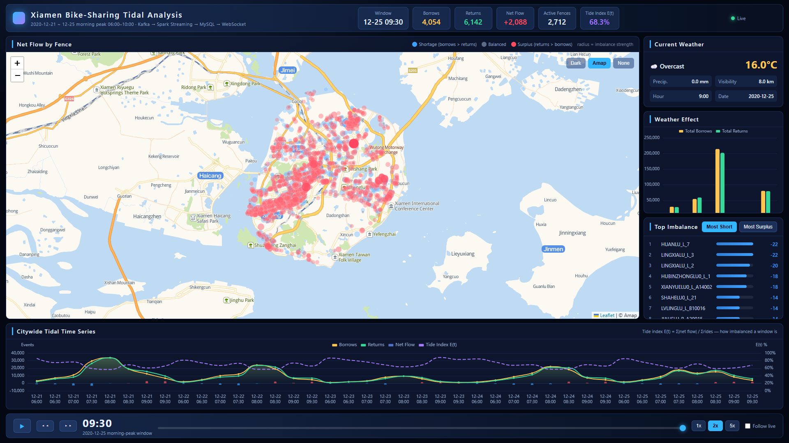

# 厦门共享单车潮汐分析 · 实时数据可视化系统

一个端到端的大数据实时分析项目：把 2020-12-21 ~ 12-25 厦门早高峰的真实共享单车订单，通过 Kafka 回放成实时事件流，用 Spark Structured Streaming 完成围栏空间匹配与 30 分钟窗口聚合，结果写入 MySQL，再由 FastAPI + WebSocket 推送到 Leaflet / ECharts 动态大屏，还原共享单车在城市中的“潮汐”迁移。

> 所有可视化数据均来自真实历史订单（22 万+ 订单事件、14,071 个电子围栏），不是模拟数据。



*截图：2020-12-25 09:30 窗口，高德底图 + 围栏净流入点层 + 潮汐指数曲线。*

## 技术栈

| 层次 | 技术 | 职责 |
| --- | --- | --- |
| 数据回放 | Kafka + kafka-python | 历史订单按时间顺序回放为实时事件流 |
| 流处理 | Spark Structured Streaming (PySpark) | 点-面空间匹配、30 分钟滚动窗口聚合、幂等写入 |
| 存储 | MySQL 8.0 / Redis 7 | 聚合结果与流状态 / 接口缓存 |
| 服务 | FastAPI + WebSocket | REST 查询与窗口更新推送 |
| 可视化 | Leaflet + ECharts | 电子围栏动态着色、潮汐指数时序、天气对比 |
| 编排 | Docker Compose | 一键启动 Zookeeper / Kafka / MySQL / Redis |

## 核心亮点

- **真实业务问题**：用“净流入 = 还车量 − 借车量”识别单车淤积（红）与缺车（蓝），辅助调度决策。
- **完整实时链路**：CSV → Kafka → Spark Streaming → MySQL → WebSocket → 浏览器，非离线批处理拼凑。
- **空间匹配优化**：1 万多个电子围栏建立 50m 网格索引，先判断点在多边形内，再用 500m 内最近围栏兜底，避免逐围栏暴力比对。
- **流处理细节**：针对历史回放的多分区水位线跃迁问题调整 watermark 策略，避免约 5 万条早期事件被误判为迟到丢弃；`ON DUPLICATE KEY UPDATE` 保证重跑幂等。
- **可交互回放**：播放 / 暂停 / 调速 / 进度条，1 秒对应 5 分钟数据时间，直观看到早高峰潮汐演变。
- **离线可用**：Leaflet / ECharts 已内置在 `frontend/vendor/`，前端不依赖 CDN。

## 系统架构


## 指标定义

- **净流入**：`return_count − borrow_count`，正数代表淤积，负数代表缺车。
- **潮汐指数 E(t)**：`Σ|净流入| / (总借车 + 总还车) × 100%`，衡量某窗口内空间失衡程度。

## 数据说明

| 文件 | 内容 | 规模 |
| --- | --- | --- |
| `Order data/order data.csv` | 订单事件：车辆 ID、经纬度、借还状态、时间 | 220,675 条 |
| `Electronic fence data/STATION.csv` | 电子围栏及四角点坐标 | 14,071 个 |
| `Weather data/Weather data.csv` | 按小时的天气（温度 / 降水 / 风速 / 能见度） | 5 天早高峰 |

完整数据为课程提供的归档，仓库中只保留实时大屏运行所需的核心数据；轨迹数据和算法归档文件较大、与实时链路无关，故未纳入仓库。

## 快速开始

环境：Docker Desktop、JDK 17、Spark 3.5.9、Python 3.10（`pyspark pandas kafka-python redis findspark shapely openpyxl mysql-connector-python chardet fastapi uvicorn`）。

```bash
cp .env.example .env          # 按需修改，Docker Compose 会自动读取
docker compose up -d          # Zookeeper + Kafka + MySQL + Redis

# 终端 2：Spark 消费端（先启动，避免丢首批数据）
bash scripts/run_consumer.sh

# 终端 3：Kafka 生产者（历史订单回放）
bash scripts/run_producer.sh

# 终端 4：FastAPI 服务 + 前端
bash scripts/run_api.sh
```

浏览器打开 <http://127.0.0.1:8000>，点击播放即可看到围栏颜色随早高峰时间演变。

`scripts/` 下的启动脚本包含作者本机的 JDK / Spark / Conda 路径，换机器后请改成自己的实际路径；也可按 [`docs/RUNBOOK.md`](docs/RUNBOOK.md) 中的手动命令启动。若数据库已有聚合结果，只需 `docker compose up -d` + `bash scripts/run_api.sh` 即可直接看大屏。地图默认使用高德瓦片（国内网络可直接访问），页面右上角可切换 Dark / Amap / None 三种底图。

## 主要接口

| 接口 | 说明 |
| --- | --- |
| `GET /api/fences` | 围栏列表与中心点 |
| `GET /api/windows` | 已有数据的时间窗口 |
| `GET /api/agg?window=...` | 指定窗口的围栏级净流入 |
| `GET /api/agg/latest` | 最新窗口数据 |
| `GET /api/series` | 全城潮汐指数时序 |
| `GET /api/weather?window=` | 当前天气与天气效应对比 |
| `GET /api/state` | 流处理进度 |
| `GET /api/health` | 健康检查 |
| `WS /ws/tidal` | 新窗口到达时主动推送 |

## 目录结构

```text
├── producer/          Kafka 历史订单回放
├── spark/             Structured Streaming 消费与聚合
├── api/               FastAPI REST + WebSocket
├── frontend/          Leaflet / ECharts 大屏与离线依赖
├── mysql/init/        结果表初始化 SQL
├── scripts/           四个终端的启动脚本
├── docs/RUNBOOK.md    完整运行手册与常见问题
└── Shared bicycle data/  核心 CSV 数据
```

本项目用于学习与作品展示。数据库默认账号密码仅适用于本机 Docker 演示环境，公开部署前请通过 `.env` 修改。
